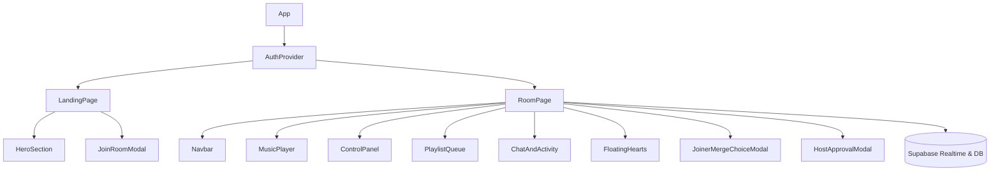
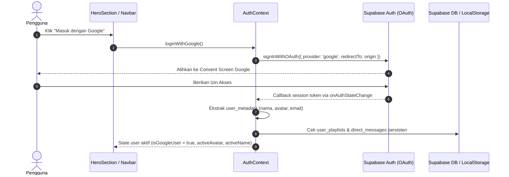
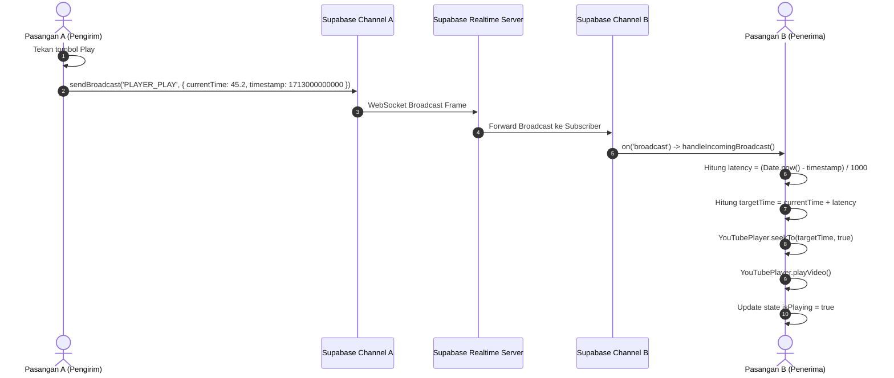

# Our Sign - System Documentation

Dokumentasi arsitektur teknis dan panduan sistem komprehensif untuk proyek **OurSync** (disebut juga **Our Sign** / `music-sync`). Dokumen ini disusun untuk memudahkan software engineer, DevOps, dan AI assistant memahami seluruh arsitektur sistem, alur logika realtime, status implementasi saat ini, hingga area teknis yang berpotensi menjadi bottleneck atau belum terselesaikan.

---

## 1. Project Overview & Tech Stack

### 1.1 Ringkasan Fungsi Utama Aplikasi
**OurSync** adalah platform web pemutar musik sinkron real-time (*synchronized music player*) yang dirancang khusus untuk pasangan jarak jauh (LDR - *Long Distance Relationship*) atau dua pengguna yang ingin mendengarkan musik bersama secara privat. 

Fitur utama meliputi:
- **Sinkronisasi Pemutaran Real-Time**: Play, Pause, Seek, dan pergantian lagu terdistribusi dengan kompensasi latensi jaringan (*network latency offset*).
- **Antrean Lagu Kolaboratif**: Kedua pengguna dapat mencari judul lagu atau menempelkan (*paste*) URL YouTube secara dinamis, mengurutkan antrean via Drag & Drop, dan menghapus antrean bersama.
- **Sistem Koleksi Playlist Pribadi & Fitur Penggabungan (Merge)**: Pengguna dapat menyimpan lagu favorit ke koleksi akun mereka dan menegosiasikan penggabungan playlist pribadi ke dalam antrean ruangan bersama pemilik ruangan (*Host*).
- **Fitur Afeksi & Obrolan Intim**: Ruang obrolan langsung (*live direct chat*) persisten dengan tab riwayat aktivitas ruangan, serta tombol interaktif "Detak Cinta" (*Send Love*) yang memicu animasi partikel hati melayang di layar pasangan secara bersamaan.
- **UI/UX Khusus "Sharp Light Mode"**: Mengusung estetika visual modern bersudut tajam 90 derajat (*sharp rectangular borders*, tanpa border-radius bulat yang generik), warna aksen solid pink (`#ec4899`), background bersih (`#fcf8f9`), dan tipografi profesional.

---

### 1.2 Core Framework & Konfigurasi Utama
- **Framework**: [React](https://react.dev/) `v19.2.8` & [React DOM](https://react.dev/) `v19.2.8`.
- **Build Tool / Bundler**: [Vite](https://vite.dev/) `v8.3.0` (Konfigurasi ES Module `"type": "module"` pada `package.json`).
- **Language**: [TypeScript](https://www.typescriptlang.org/) `~6.0.2` dengan mode *strict type-checking* (`tsconfig.app.json` dan `tsconfig.node.json`).
- **Routing**: [React Router](https://reactrouter.com/) `v7.18.4` (`react-router-dom`).
- **Compiler Plugin**: `@vitejs/plugin-react` `v6.1.1` dan `@tailwindcss/vite` `v4.3.3`.

---

### 1.3 Styling & UI Engine
- **CSS Engine**: [Tailwind CSS v4](https://tailwindcss.com/) (`v4.3.3`) menggunakan integrasi plugin native Vite (`@tailwindcss/vite`).
- **Design Language**: *Sharp Light Aesthetic* — Desain minimalis elegan dengan sudut siku 90 derajat (`rounded-none`), palette warna kontras lembut (Solid Pink `#ec4899`, Pink Hover `#db2777`, Background `#fcf8f9`, Card Border `#f0dbe2`, Neutral Text `#1e1b1d`).
- **Tipografi**:
  - Headings: `Outfit` (Google Fonts, bobot 500-900).
  - Body / UI: `Plus Jakarta Sans` (Google Fonts, bobot 300-700).
- **Icon Pack**: `lucide-react` `v1.55.0`.
- **Animasi**:
  - CSS Keyframe `@keyframes floatUp` murni untuk partikel "Floating Hearts".
  - Equalizer bar dinamis murni berbasis CSS state di komponen `MusicPlayer`.
  - Custom sleek scrollbar bersudut siku di `src/index.css`.

---

### 1.4 State & Realtime Engine
Aplikasi tidak menggunakan state manager eksternal berat (seperti Redux atau Zustand), melainkan mengombinasikan:
- **React Context API**: Digunakan pada `AuthContext` untuk memusatkan sesi pengguna, identitas profil, dan mode Guest/Google.
- **Supabase Realtime Channel (WebSockets)**:
  - Channel name: `room:${roomId}`.
  - Parameter: `eventsPerSecond: 10`.
  - **Broadcast Engine (`broadcast: { self: false }`)**: Mengirim sinyal kontrol audio, sinkronisasi antrean, pesan obrolan, dan reaksi afeksi ke pasangan tanpa echo ke pengirim.
  - **Presence Engine (`presence: { key: clientId }`)**: Mendeteksi secara langsung apakah pasangan sedang online/offline serta menangkap event `join` dan `leave`.
- **Database Persistence**: Supabase PostgreSQL tables (`rooms`, `direct_messages`, `user_playlists`).
- **Local Fallback**: `localStorage` (untuk caching playlist, chat sesi offline/guest, dan nickname) dan `sessionStorage` (untuk menentukan kepemilikan host sesi).

---

### 1.5 Authentication Architecture
- **Provider**: Google OAuth via [Supabase Auth](https://supabase.com/docs/guides/auth) (`supabase.auth.signInWithOAuth`).
- **Dual-Mode User Support**:
  1. **Google Authenticated User**: Data user diambil dari metadata Supabase (`session.user.user_metadata`). Playlist pribadi dan pesan obrolan disimpan secara persisten di database Supabase sehingga dapat diakses lintas perangkat.
  2. **Guest User (Tamu)**: Pengguna tidak diwajibkan login untuk mendengarkan musik. Cukup memasukkan nama panggilan (*nickname*). Sistem secara otomatis mengalokasikan identitas anonim unik `guest_<random_id>` yang disimpan di `localStorage`.

---

### 1.6 Audio Player Engine
- **Engine**: Headless [YouTube IFrame Player API](https://developers.google.com/youtube/iframe_api_reference) via `react-youtube` `v10.1.0`.
- **Arsitektur Pemutar Headless**:
  IFrame native bawaan YouTube disembunyikan sepenuhnya dari viewport layar dengan teknik offscreen CSS:
  ```tsx
  <div className="fixed -top-[9999px] -left-[9999px] w-1 h-1 opacity-0 pointer-events-none overflow-hidden">
    <YouTube videoId={videoId} opts={youtubeOpts} onReady={handleReady} onStateChange={handleStateChange} />
  </div>
  ```
  Antarmuka digantikan 100% oleh custom card player yang menampilkan thumbnail YouTube beresolusi tinggi, equalizer wave animation, judul lagu, nama artis, dan seek bar kustom.
- **Dynamic Metadata Fetcher**:
  Menggunakan endpoint publik oEmbed `https://noembed.com/embed?url=https://www.youtube.com/watch?v={videoId}` di `src/utils/youtube.ts`. Memungkinkan sistem mengambil judul video dan artis asli YouTube secara otomatis tanpa memerlukan API Key YouTube Data v3.

---

### 1.7 Daftar Dependensi Kunci (`package.json`)

| Dependensi | Versi | Peran Teknis dalam Aplikasi |
|---|---|---|
| `react` | `^19.2.8` | Core UI library. |
| `react-dom` | `^19.2.8` | Rendering React ke DOM browser. |
| `react-router-dom` | `^7.18.4` | Client-side routing SPA (Landing Page & Dynamic Room). |
| `@supabase/supabase-js` | `^2.117.3` | SDK Supabase untuk Realtime Broadcast, Presence, Google Auth, dan database query. |
| `react-youtube` | `^10.1.0` | React wrapper untuk YouTube IFrame Player API. |
| `lucide-react` | `^1.55.0` | Icon library berbasis SVG. |
| `@tailwindcss/vite` | `^4.3.3` | Bundler plugin resmi Tailwind CSS v4 untuk Vite. |
| `tailwindcss` | `^4.3.3` | Utility-first CSS framework versi 4. |
| `typescript` | `~6.0.2` | Static typing & type checking. |
| `vite` | `^8.3.0` | Next-generation frontend build tool & dev server. |

---

## 2. Project Directory & File Architecture

```
music-sync/
├── .env                         # Konfigurasi aktif environment variables (Supabase URL & Anon Key)
├── .env.example                 # Template referensi konfigurasi environment variables
├── .gitignore                   # Daftar file/folder yang diabaikan oleh Git
├── eslint.config.js             # Konfigurasi linter ESLint v10
├── index.html                   # Entry point dokumen HTML (Font Google Outfit & Plus Jakarta Sans)
├── package.json                 # Manifest dependensi dan npm scripts
├── tsconfig.json                # Root TypeScript configuration
├── tsconfig.app.json            # TypeScript configuration untuk kode client (/src)
├── tsconfig.node.json           # TypeScript configuration untuk tooling/Vite
├── vercel.json                  # Konfigurasi rewrite SPA Vercel untuk dynamic routing (/room/*)
├── vite.config.ts               # Konfigurasi Vite (React plugin & Tailwind plugin)
├── public/                      # Static public assets (favicon.svg, icons.svg)
└── src/
    ├── main.tsx                 # Root bootstrap React DOM (StrictMode & index.css)
    ├── App.tsx                  # Root Application component (AuthProvider & Router configuration)
    ├── App.css                  # File CSS template bawaan Vite (legacy/unused)
    ├── index.css                # Global design system (Tailwind v4, font variables, sharp-card utilities)
    ├── context/
    │   └── AuthContext.tsx      # State manager autentikasi Google, profil user, dan Guest fallback
    ├── lib/
    │   └── supabaseClient.ts    # Inisialisasi Supabase client dengan config realtime rate-limit
    ├── types/
    │   └── index.ts             # Definisi interface TypeScript (Song, Chat, Activity, RoomData, Broadcast)
    ├── data/
    │   └── mockData.ts          # State inisial kosong default untuk antrean baru dan aktivitas
    ├── utils/
    │   ├── personalPlaylist.ts  # Utilitas CRUD playlist akun (hybrid Supabase DB + LocalStorage)
    │   ├── roomCode.ts          # Smart-parser URL / kode ruangan (ekstraksi kode dari URL lengkap)
    │   └── youtube.ts           # Ekstraksi YouTube ID regex, thumbnail helper, oEmbed title scraper
    ├── components/
    │   ├── Navbar.tsx           # Header navigasi, Room ID badge, copy code, partner presence, profile/logout
    │   ├── HeroSection.tsx      # Komponen landing page, Google auth CTA, input nickname, create/join buttons
    │   ├── JoinRoomModal.tsx    # Modal dialog untuk memasukkan atau mem-paste kode/URL ruangan
    │   ├── MusicPlayer.tsx      # Custom media player UI, cover art sharp 90°, audio visualizer equalizer
    │   ├── ControlPanel.tsx     # Player controls (Seekbar, Prev/Next, Play/Pause, Re-sync, Volume, Send Love)
    │   ├── PlaylistQueue.tsx    # Antrean kolaboratif, pencarian lagu, input URL manual, drag-and-drop reordering
    │   ├── ChatAndActivity.tsx  # Dual tab sidebar: Live chat pasangan & riwayat aktivitas pemutaran
    │   ├── FloatingHearts.tsx   # Canvas partikel animasi hati melayang saat tombol afeksi ditekan
    │   └── MergePlaylistModal.tsx # Dialog persetujuan penggabungan playlist personal ke antrean ruangan
    └── pages/
        ├── LandingPage.tsx      # Halaman utama landing, inisiasi pembuatan room atau trigger join modal
        └── RoomPage.tsx         # Halaman inti ruang dengar bersama (~1400 baris logika sinkronisasi)
```

---

## 3. Pages & Routing Architecture

Aplikasi menggunakan routing SPA dari `react-router-dom` yang didaftarkan di `src/App.tsx`. Seluruh rute dilindungi oleh rewrite rule di `vercel.json` agar direct link tidak menghasilkan error 404 pada production hosting.

### 3.1 Daftar Rute

| Path URL | Proteksi Auth | Halaman Komponen | Deskripsi Singkat |
|---|---|---|---|
| `/` | Publik (Opsional Auth) | `LandingPage` | Halaman selamat datang, input nama panggilan, login Google, buat room baru, atau gabung room. |
| `/room/:roomId` | Publik (Opsional Auth) | `RoomPage` | Ruang dengar musik sinkron real-time privat antar-pasangan. |
| `*` | Publik | `<Navigate to="/" replace />` | Wildcard fallback: mengalihkan semua URL yang tidak dikenal kembali ke `/`. |

---

### 3.2 Detail Workflow Halaman

#### 1. LandingPage (`/`)
- **Tujuan**: Titik masuk pengguna untuk mengonfigurasi profil sesi (Guest atau Google User) dan menginisiasi ruang dengar.
- **Workflow**:
  1. Pengguna dapat memilih untuk masuk menggunakan Google (opsional). Jika tidak, sistem membaca nickname terakhir dari `localStorage`.
  2. Pengguna mengisi atau mengubah nama panggilan di input box.
  3. **Aksi Buat Room**: Memanggil `handleCreateRoom()`, menyimpan nickname ke `localStorage`, men-generate kode unik berformat `LOVE-XXXX` (angka 4 digit acak), mencatat status kepemilikan host di `sessionStorage.setItem('oursync_host_' + code, 'true')`, lalu navigasi otomatis ke `/room/LOVE-XXXX`.
  4. **Aksi Gabung Room**: Membuka `JoinRoomModal`. Pengguna menempelkan URL atau kode room pasangan. Sistem membersihkan kode melalui `cleanRoomCode()`, mencatat `sessionStorage.setItem('oursync_host_' + code, 'false')`, lalu berpindah ke `/room/:code`.
- **Komponen Utama**:
  - `HeroSection`: Card setup sesi, status akun, input nama, CTA button.
  - `JoinRoomModal`: Input kode dengan smart clipboard paste listener.

#### 2. RoomPage (`/room/:roomId`)
- **Tujuan**: Pusat orkestrasi pemutaran musik, sinkronisasi audio, antrean lagu, obrolan real-time, dan status kehadiran pasangan.
- **Workflow**:
  1. Membaca parameter `:roomId` dari URL.
  2. Menginisialisasi koneksi Supabase Realtime channel `room:${roomId}`.
  3. Melakukan *handshake presence* untuk mengumumkan keberadaan user lokal (`clientId`) dan mendeteksi apakah pasangan sudah berada di ruangan (`isPartnerOnline`).
  4. Meminta sinkronisasi antrean terkini dari peer yang aktif via event `REQUEST_ROOM_SYNC`.
  5. Jika user bukan Host dan memiliki lagu di playlist pribadi akun, sistem memunculkan `JoinerMergeChoiceModal`.
  6. Mengontrol pemutar YouTube headless di latar belakang dan memperbarui tampilan antrean lagu, seek bar, dan chat secara real-time.
- **Komponen Utama**:
  - `Navbar`, `MusicPlayer`, `ControlPanel`, `PlaylistQueue`, `ChatAndActivity`, `FloatingHearts`, `JoinerMergeChoiceModal`, `HostApprovalModal`.

---

## 4. Components Breakdown

### 4.1 Layout Components
1. **`Navbar.tsx`**:
   - Menampilkan logo brand OurSync.
   - Menampilkan badge **Room ID** yang dapat disalin (*copy-to-clipboard*) dengan satu kali klik (dilengkapi feedback toast floating).
   - Menampilkan indikator kehadiran pasangan (Pastel Emerald badge "Online bersama [Nama]" atau "Menunggu pasangan...").
   - Menampilkan foto avatar profil & nama akun jika login Google, atau tombol keluar ruang untuk Guest.
   - Dilengkapi menu *mobile slide-over drawer* bersudut tajam untuk layar smartphone.
2. **Container Utama (`RoomPage.tsx`)**:
   - Layout grid responsif: 7 kolom di sebelah kiri untuk Media Player & Controls, 5 kolom di sebelah kanan untuk Playlist Queue & Chat/Activity.

---

### 4.2 Feature Components
1. **`MusicPlayer.tsx`**:
   - Membungkus komponen `react-youtube` secara tersembunyi (*headless*).
   - Menampilkan thumbnail cover art bersudut siku 90 derajat dengan efek scale saat memutar.
   - Menampilkan equalizer wave bar berbasis CSS animasi aktif.
   - Lencana status: "Sinkron Real-Time • Supabase Connected", "Audio Sinkron", dan "Ditambahkan oleh: [Nama]".
2. **`ControlPanel.tsx`**:
   - Seek bar horizontal presisi dengan gradien pink progresif.
   - Label waktu berjalan dan total durasi (`mm:ss`).
   - Tombol kontrol pemutaran utama: **Previous**, **Play / Pause** (Solid Pink Sharp Button), **Next**.
   - Tombol utilitas: **Shuffle**, **Repeat**, dan tombol **Re-sync** manual (`RotateCcw`).
   - Tombol **Detak Cinta** (`Heart`) untuk mengirimkan animasi afeksi.
   - Pengatur volume suara privat mandiri beserta toggle **Mute / Unmute** (perubahan volume tidak disinkronkan ke pasangan agar tidak mengganggu kenyamanan telinga masing-masing).
3. **`PlaylistQueue.tsx`**:
   - Menampilkan daftar antrean lagu aktif dalam ruangan.
   - Form pencarian cepat dan penambahan URL YouTube langsung.
   - Form penambahan manual lagu (Judul, Artis, URL).
   - Dukungan **HTML5 Drag and Drop** (`onDragStart`, `onDragOver`, `onDrop`) untuk mengubah urutan lagu (*reordering*).
   - Tombol **Bookmark / Simpan ke Playlist Pribadi** untuk setiap lagu.
   - Tombol **Muat Koleksi Pribadi** untuk mengimpor seluruh playlist pribadi user ke dalam antrean ruangan.
4. **`ChatAndActivity.tsx`**:
   - **Tab Obrolan Pasangan**: Gelembung pesan bersudut tajam (*sharp bubble*), pembeda pesan sendiri (*pink pastel*) dan pesan pasangan (*soft gray*), input chat, dan tombol kirim detak cinta.
   - **Tab Aktivitas Musik**: Log otomatis saat user memutar lagu, menjeda, mengubah antrean, mengirim reaksi, atau bergabung/keluar ruangan.
5. **`FloatingHearts.tsx`**:
   - Menghasilkan partikel SVG hati yang naik ke atas layar dengan rotasi dan scale acak saat event afeksi `SEND_LOVE` diterima.
6. **`MergePlaylistModal.tsx`**:
   - `JoinerMergeChoiceModal`: Ditampilkan pada pengguna yang baru bergabung jika memiliki playlist personal.
   - `HostApprovalModal`: Ditampilkan pada pemilik ruangan saat menerima permintaan penggabungan lagu, dilengkapi preview daftar lagu yang akan masuk.

---

### 4.3 UI & Common Components
1. **`HeroSection.tsx`**:
   - Header hero tipografi berbobot tinggi.
   - Kartu setup sesi dengan login Google interaktif atau mode nickname guest.
   - Feature highlight grid (Sinkronisasi Presisi, Antrean Kolaboratif, Privat & Intim).
2. **`JoinRoomModal.tsx`**:
   - Dialog modal modal pop-up dengan interceptor `handlePaste` untuk membedah URL panjang menjadi kode room bersih.
3. **Badge, Input & Buttons**:
   - Dibuat seragam menggunakan prinsip *Sharp Rectangular Design*: border tegas (`border`, `border-2`), background putih atau `#fdf2f6`, dan tanpa sudut membulat (`rounded-none`).

---

### 4.4 Props, Local State & Dependency Matrix



---

## 5. Core Features & Business Logic

### 5.1 Google Authentication Flow



1. **Inisialisasi & Session Persistence**:
   Saat aplikasi dimuat, `AuthContext` mengeksekusi `supabase.auth.getSession()` dan mendaftarkan listener `supabase.auth.onAuthStateChange`. Token sesi disimpan otomatis oleh Supabase SDK di `localStorage`.
2. **Guest Fallback Logic**:
   Jika pengguna tidak login dengan Google (`user === null`), context membaca `localStorage.getItem('oursync_nickname')` atau fallback ke `'Kamu'`. Untuk ID unik pengguna, dibuat identifier acak `guest_<string>` yang dipersistensikan di `localStorage.setItem('oursync_guest_id', gid)`.

---

### 5.2 Room / Session Management
1. **Pembuatan Room ID**:
   Room ID di-generate di sisi client dengan format `LOVE-` ditambah 4 digit angka acak (misal: `LOVE-8506`).
2. **Identifikasi Peran (Host vs Joiner)**:
   - Pembuat room menyimpan tanda di session browser: `sessionStorage.setItem('oursync_host_' + roomId, 'true')`.
   - Pengguna yang bergabung melalui kode menyimpan `sessionStorage.setItem('oursync_host_' + roomId, 'false')`.
3. **Smart Parser Kode Ruangan (`cleanRoomCode`)**:
   Pengguna dapat menempelkan berbagai variasi teks ke form gabung tanpa takut format rusak:
   - URL Localhost: `http://localhost:5173/room/LOVE-5411` $\rightarrow$ `LOVE-5411`
   - URL Production: `https://our-sync.vercel.app/room/LOVE-5411?ref=chat` $\rightarrow$ `LOVE-5411`
   - Path biasa / huruf kecil / spasi: `love 5411` $\rightarrow$ `LOVE-5411`
4. **Presence Tracking**:
   Klien bergabung ke Supabase Realtime Channel dengan metadata:
   ```ts
   channel.track({ user: activeName, online_at: new Date().toISOString() })
   ```
   Klien lain mendengarkan event `presence.sync`, `presence.join`, dan `presence.leave` untuk memperbarui status online pasangan secara dinamis.

---

### 5.3 Realtime Audio Sync Mechanism

Sinkronisasi audio adalah fitur paling fundamental di OurSync. Seluruh komunikasi realtime berjalan di atas Supabase Broadcast Channel `room:${roomId}` dengan payload `BroadcastEvent`.



#### A. Mekanisme Play / Pause / Seek:
1. **Play Action**:
   - Pengguna lokal memutar video: mengambil `currentTime` dari YouTube Player dan merekam `timestamp: Date.now()`.
   - Mengirim event `PLAYER_PLAY`.
   - Penerima menghitung latensi jaringan satu arah:
     $$\Delta t = \max\left(0, \frac{\text{Date.now()} - \text{timestamp}}{1000}\right)$$
   - Menghitung posisi pemutaran target:
     $$T_{\text{target}} = \text{currentTime} + \Delta t$$
   - Memanggil `player.seekTo(targetTime, true)` dan `player.playVideo()`.
2. **Pause Action**:
   - Mengirim `PLAYER_PAUSE` beserta posisi detik terakhir `currentTime`.
   - Penerima langsung memanggil `player.seekTo(currentTime, true)` dan `player.pauseVideo()`.
3. **Seek Action**:
   - Mengirim `PLAYER_SEEK` dengan parameter `newTime`.
   - Penerima memanggil `player.seekTo(newTime, true)` dan memperbarui progress slider.

#### B. Mekanisme Pergantian & Antrean Lagu:
- **`CHANGE_SONG`**: Mengirim `songId` dan `shouldPlay`. Penerima mencari indeks lagu di antrean lokal, mereset progress ke `0`, dan memicu pemutaran.
- **`ADD_QUEUE` & `REMOVE_QUEUE`**: Menambah atau memotong array antrean di kedua sisi secara serempak.
- **`REORDER_QUEUE`**: Menghasilkan array antrean baru dari hasil drag-and-drop dan menyinkronkannya ke pasangan.

#### C. Mekanisme State Handshake Saat Bergabung (`REQUEST_ROOM_SYNC`):
Ketika pengguna baru bergabung ke channel (`status === 'SUBSCRIBED'`), klien tersebut secara proaktif memancarkan event:
```ts
{ type: 'REQUEST_ROOM_SYNC', payload: { requesterId: clientId } }
```
Klien yang sudah berada di ruangan akan merespons dengan event `RESPONSE_ROOM_SYNC` yang menyertakan snapshot antrean lengkap, indeks lagu yang sedang aktif, status pemutaran (`isPlaying`), dan detik pemutaran saat itu (`currentTime`).

#### D. Mekanisme Auto-Advance (Lagu Otomatis Lanjut):
Ketika pemutar YouTube memancarkan state change `0` (video selesai/ended), komponen `MusicPlayer` memicu callback:
```ts
if (state === 0) {
  handleAutoAdvanceNext()
}
```
Sistem otomatis menghitung indeks berikutnya: `(currentSongIndex + 1) % queue.length`, memutar lagu berikutnya, memancarkan event `CHANGE_SONG`, dan memperbarui baris database room.

---

## 6. Current Implementation Status & Unfinished Parts

Sebagai Senior Architect, analisis berikut membedah kondisi aktual kode secara faktual, objektif, dan transparan:

### 6.1 Fitur yang Berfungsi Penuh (Fully Implemented)
- [x] **Pemisahan Siklus Hidup Koleksi Pribadi vs Room Queue (Isolated Lifecycle)**: Koleksi pribadi pengguna tersimpan independen secara pure CRUD di bawah key terisolasi (`oursync_lib_user_${userId}` untuk Google Auth dan `oursync_lib_guest_${guestId}` untuk Guest) serta tabel Supabase `user_playlists`. Tindakan memilih antrean room orang lain (*use host playlist*) tidak pernah menimpa koleksi pribadi joiner.
- [x] **Google OAuth Login via Supabase**: Berjalan lancar, mampu memuat foto avatar, email, nama lengkap, dan session persistence.
- [x] **Mode Tamu (Guest Mode)**: Pengguna tanpa akun Google dapat langsung menggunakan platform menggunakan fallback nama lokal dan guest ID.
- [x] **Koneksi Supabase Realtime Broadcast**: Pengiriman sinyal kontrol audio (Play, Pause, Seek, Change Song, Queue updates, Chat, Send Love) berjalan secara instan.
- [x] **Supabase Presence Tracking**: Deteksi online/offline pasangan dan log riwayat kehadiran terhubung akurat.
- [x] **Headless YouTube Integration**: Audio berjalan mulus tanpa menampilkan iframe YouTube yang mengganggu estetika.
- [x] **Ekstraksi YouTube & oEmbed Scraper**: Mampu mengekstrak ID dari berbagai variasi URL dan mengambil thumbnail serta judul lagu secara dinamis tanpa API key.
- [x] **HTML5 Drag & Drop Reordering**: Pengguna dapat mengubah urutan lagu secara visual di antrean dan otomatis tersinkronisasi ke pasangan.
- [x] **Detak Cinta (Floating Hearts Animation)**: Trigger afeksi memunculkan partikel hati melayang di kedua layar secara realtime.
- [x] **Smart Room Code Parser**: Parser URL cerdas yang mampu mengisolasi kode ruangan dari URL panjang atau teks berantakan.

---

### 6.2 Fitur Setengah Jadi (Partially Implemented / Mocked)

1. **Tombol Shuffle & Repeat di `ControlPanel.tsx`**:
   - **Kondisi**: Tombol Shuffle (`Shuffle`) dan Repeat (`Repeat`) memiliki local state (`isShuffle`, `isRepeat`) yang dapat diklik aktif/non-aktif pada UI.
   - **Masalah**: Kedua state ini **sama sekali tidak dihubungkan ke logika antrean pemutaran** di `RoomPage.tsx`. Logika `handleAutoAdvanceNext()` di `RoomPage.tsx` selalu menjalankan lagu secara sekuensial linear:
     ```ts
     const nextIdx = (currentSongIndex + 1) % queue.length
     ```
     Lagu tidak akan teracak meskipun ikon Shuffle menyala, dan lagu tidak akan mengulang jika ikon Repeat aktif.
2. **Tombol Re-sync di `ControlPanel.tsx`**:
   - **Kondisi**: Tombol `RotateCcw` menampilkan teks animasi "Sinkronisasi disesuaikan" selama 2 detik dan memanggil prop `onTriggerResync?.()`.
   - **Masalah**: Di `RoomPage.tsx`, prop `onTriggerResync` **tidak dioper/diteruskan** ke `<ControlPanel />`. Akibatnya tombol tersebut hanya berfungsi sebagai dummy visual feedback tanpa mengeksekusi penyesuaian seek ke pasangan.
3. **Fallback Hardcoded YouTube Video ID**:
   - Jika pengguna memasukkan teks pencarian yang bukan URL YouTube valid, kode di `PlaylistQueue.tsx` (baris 78 & 93) dan `MusicPlayer.tsx` (baris 27) melakukan fallback ke hardcoded video ID:
     ```ts
     videoId: 'GxldQ9eX2wo' // Video YouTube "Toxic" - Britney Spears
     thumbnail: 'https://images.unsplash.com/photo-1518609878373-06d740f60d8b?...'
     ```
   - Sistem belum mengintegrasikan search engine YouTube backend (misal via Invidious API atau YouTube Data API) untuk mencari video sebenarnya berdasarkan kata kunci string.

---

### 6.3 Technical Debt & Area Belum Bersih
- **`src/App.css` (Dead Code)**:
  File `App.css` berisi 185 baris CSS bawaan template Vite default (`.counter`, `.hero`, `#next-steps`, `.ticks`, dll.). File ini **tidak diimpor** di `App.tsx` maupun `main.tsx`, sehingga menjadi dead-code yang membebani repositori.
- **`src/data/mockData.ts` (Empty Mock)**:
  File ini hanya berisi ekspor array kosong (`initialPlaylist = []`, `initialMessages = []`). Sebaiknya dideklarasikan langsung di tempat jika tidak memiliki dataset template bawaan.
- **Komponen Monolitik `RoomPage.tsx`**:
  `RoomPage.tsx` memiliki panjang mencapai **1416 baris kode**. Seluruh logika state (audio, chat, antrean, presence, database sync, broadcast handlers) tertumpuk dalam satu file raksasa tanpa custom hooks (seperti `useAudioSync`, `useRoomPresence`, `useRoomChat`).

---

### 6.4 Known Bugs & Sync Bottlenecks

1. **Browser Autoplay Policy & Audio Blocking**:
   Kebijakan keamanan browser modern (khususnya Google Chrome, Safari, dan browser mobile iOS/Android) memblokir pemutaran media audio/video secara terprogram jika belum ada gestur interaksi fisik pengguna (*user gesture*) pada tab tersebut.
   - *Kasus Nyata*: Jika Pasangan A menekan "Play", Pasangan B yang baru saja membuka tab tanpa mengklik layar tidak akan mendengar musik karena browser memblokir perintah `.playVideo()`.
2. **Ketiadaan Periodic Heartbeat (Audio Drift)**:
   Sinkronisasi saat ini **hanya** dikirimkan saat event diskrit terjadi (Play, Pause, Seek). 
   - *Masalah*: Kecepatan buffering jaringan kedua pengguna sering berbeda beberapa persen. Dalam lagu berdurasi 4 menit, audio kedua pasangan bisa mengalami *drift* (pergeseran jeda 0.5 - 2 detik) secara perlahan tanpa ada mekanisme koreksi otomatis berkala (*periodic heartbeat sync* setiap 5-10 detik).
3. **Race Condition pada Dual Host / Simultan Kontrol**:
   Sistem tidak menerapkan locking atau token giliran. Jika kedua pasangan menekan tombol Play/Pause secara bersamaan dalam jeda waktu 100ms, kedua pesan broadcast akan saling tumpang tindih (*race condition*) dan menyebabkan pemutar tersendat (*stutter*).
4. **Hilangnya Status Host pada Page Refresh**:
   Status kepemilikan ruangan dicatat pada `sessionStorage`:
   ```ts
   sessionStorage.getItem('oursync_host_' + roomId) === 'true'
   ```
   Jika pembuat ruangan menutup tab lalu membukanya kembali dari riwayat URL, `sessionStorage` dapat hilang atau bernilai `false`, menyebabkan sistem menganggap pembuat ruangan sebagai tamu biasa (*Joiner*).
5. **Ketergantungan Skema Database Supabase**:
   Jika pengguna mengonfigurasi proyek Supabase baru tanpa mengeksekusi migrasi tabel SQL untuk `rooms`, `direct_messages`, dan `user_playlists`, aplikasi akan tetap berjalan melalui WebSockets broadcast, namun fitur persistensi riwayat obrolan dan playlist akun akan mengalami kegagalan query `404 / 400` di konsol browser.

---

## 7. Environment Variables & Setup

### 7.1 Daftar Environment Variables

Konfigurasi disimpan pada file `.env` di root direktori proyek:

```env
# URL endpoint proyek Supabase Anda
VITE_SUPABASE_URL=https://your-project.supabase.co

# Anon Public API Key dari dashboard Supabase (Project Settings > API)
VITE_SUPABASE_ANON_KEY=your-supabase-anon-key
```

> [!IMPORTANT]
> Jangan pernah memasukkan `SUPABASE_SERVICE_ROLE_KEY` ke dalam variabel lingkungan frontend berawalan `VITE_`, karena kunci tersebut memiliki hak akses bypass RLS dan akan terekspos ke publik melalui bundle JavaScript client.

---

### 7.2 Struktur Tabel Database Supabase yang Diperlukan

Untuk mendukung seluruh fitur persistensi OurSync secara penuh, proyek Supabase harus memiliki 3 tabel berikut:

```sql
-- 1. Tabel Status Sesi Ruangan
create table public.rooms (
  room_id text primary key,
  playlist jsonb default '[]'::jsonb,
  current_song jsonb,
  is_playing boolean default false,
  current_time numeric default 0,
  updated_at timestamp with time zone default timezone('utc'::text, now())
);

-- 2. Tabel Obrolan Persisten Antar-Akun
create table public.direct_messages (
  id text primary key,
  sender_id text not null,
  sender_name text not null,
  receiver_id text,
  room_id text not null,
  message text not null,
  created_at timestamp with time zone default timezone('utc'::text, now())
);

-- 3. Tabel Playlist Pribadi Pengguna
create table public.user_playlists (
  user_id text primary key,
  playlist jsonb default '[]'::jsonb,
  updated_at timestamp with time zone default timezone('utc'::text, now())
);

-- Aktifkan Realtime pada tabel di Supabase Dashboard (Database -> Replication)
```

---

### 7.3 Langkah Instalasi & Menjalankan Local Dev Server

1. **Clone & Masuk ke Direktori Proyek**:
   ```bash
   cd music-sync
   ```

2. **Instalasi Seluruh Dependensi**:
   ```bash
   npm install
   ```

3. **Konfigurasi Environment Variables**:
   Salin template `.env.example` menjadi `.env` dan masukkan kredensial Supabase Anda:
   ```bash
   cp .env.example .env
   ```

4. **Menjalankan Server Pengembangan Lokal**:
   ```bash
   npm run dev
   ```
   Aplikasi akan berjalan di `http://localhost:5173`.

5. **Validasi Type Checking & Production Build**:
   ```bash
   npm run build
   ```
   Perintah ini akan menjalankan TypeScript compiler (`tsc -b`) dan membuat bundle siap rilis di folder `dist/`.

6. **Preview Production Build**:
   ```bash
   npm run preview
   ```

---

*Dokumentasi ini disusun secara objektif dan mendalam berdasarkan kode sumber aktual per tanggal 15 Oktober 2026 untuk proyek OurSync.*
